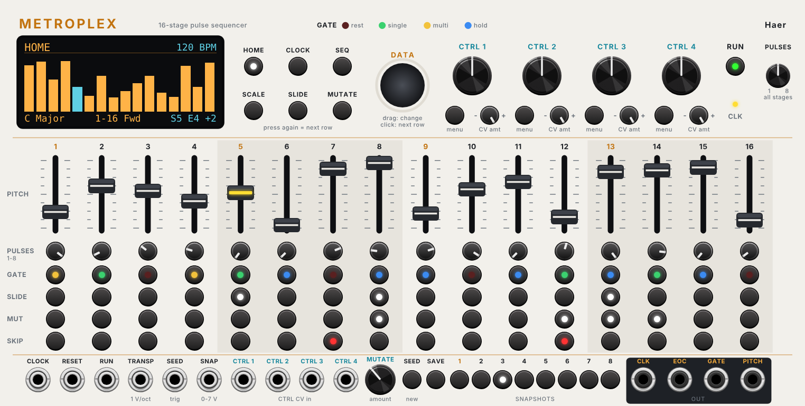

# Metroplex

A 16-stage pulse-count sequencer for VCV Rack 2, by Haer. Each stage has a pitch
slider and a pulse count, and the stages share one sequence. It has
Mutate (a seeded, reversible way to vary the pattern), 8 snapshots, slides
(including Acid), skips, scale quantising, a menu
display, and four CTRL knobs that you can point at almost any setting.

The way it works follows the Intellijel Metropolix, but Metroplex is an
independent module written from scratch. It is not made by or connected with
Intellijel, and it shares no code with the Quo Vadis¿ plugin.



## Install (Apple Silicon Mac)

1. Download `Metroplex-2.1.0-mac-arm64.vcvplugin` from the
   [latest release](https://github.com/hardyfinn/metroplex/releases/tag/latest).
2. In Rack, choose **Help → Open user folder**, then close Rack.
3. Put the file, unopened, into the `plugins-mac-arm64` folder.
4. Start Rack and search for **Metroplex**.

## First patch

1. Add **Metroplex**, a VCO, an envelope (ADSR) and a VCA. If you have the
   disting NT as your audio interface, use your usual Audio module out.
2. **PITCH** → VCO V/Oct. **GATE** → ADSR gate. VCO → VCA in, ADSR → VCA CV,
   VCA → audio out.
3. Leave **CLOCK** unpatched. Metroplex runs on its own clock at 120 BPM
   (4 pulses per beat, so each pulse is a 16th note).
4. Move a few sliders. Set stage 4's **PULSES** knob to 3 and its **GATE** to
   multi (yellow): it now plays three 16ths in a row. Set stage 8 to hold
   (blue) with 4 pulses for a long note.

To sync with Live, patch a 16th-note clock (CV Tools through the disting NT)
into **CLOCK** and Live's transport reset into **RESET**.

## Stage controls (one column per stage)

| Control | What it does |
|---|---|
| **PITCH** slider | The stage's note. The slider covers the **Slider range** (1 to 4 octaves) and always lands on a note in the chosen scale. Hover to see the note name. |
| **PULSES** (1-8) | How many clock pulses the stage lasts. |
| **GATE** button | Click to cycle the gate type. Dark red = **Rest** (no gate). Green = **Single** (one gate on the first pulse). Yellow = **Multi** (a gate on every pulse). Blue = **Hold** (one long gate across all the stage's pulses). |
| **SLIDE** button | Glide into this stage's note. The **Slide** page sets how. |
| **MUT** button | On (lit) = Mutate may change this stage. Off = the stage is locked and always plays as set. |
| **SKIP** button (red) | The stage is left out completely: the sequence jumps straight past it, as if it wasn't there. If every stage is skipped, the sequence keeps time in silence. |

**PULSES (all stages)**, the small knob at the top right, sets every stage's
pulse count at once. Turning it overwrites all 16 PULSES knobs, which you can
then change one by one again.

The slider's light shows the stage that is playing. Stages outside the playing
window (see **Start stage** and **Length**) are shown dimmer.

## The display and its menus

Six page buttons choose what the display shows: **HOME**, **CLOCK**, **SEQ**,
**SCALE**, **SLIDE** and **MUTATE**. Each CTRL knob has its own **menu**
button too.

- **Change the highlighted row**: drag the **DATA** encoder up or down, or use
  the scroll wheel over it. Hold Shift for steps of 10 (handy for tempo).
- **Move to the next row**: click the encoder, or press the page button again.
  You can also click a row on the display, and drag on the display itself.
- **On HOME**, turning the encoder flips through the pages.
- **Right-click the display** for a menu of everything on that page, with
  named lists and sliders. The module's own right-click menu has every page.

A cyan **C1** or **C2** badge on a row means that CTRL knob is setting it right
now. The row shows the knob's value and you can't change it from the menu until
you unassign the knob.

| Page | Rows |
|---|---|
| **HOME** | 16 bars, one per stage, showing each note's height. Cyan = playing now. An outline means a rest. Dark bars are skipped or outside the window. A cyan tick means Mutate has changed that stage. The title shows the snapshot (and the one waiting to come in) and the Mutate amount. Along the bottom: key and scale, start-end and play order, and the current stage and note. |
| **CLOCK** | **Tempo** (20-300 BPM, internal clock only), **Clock div** (/1 to /16, also divides an external clock), **Gate length** (1-99% of a pulse) |
| **SEQ** | **Start stage** (1-16: where the window starts), **Length** (1-16 stages; the window wraps past 16, so start 14 with length 4 plays 14, 15, 16, 1), **Snapshot switch** (Now or End of cycle), **Play order**: Forward, Reverse, Pendulum (no repeats at the ends), Ping-pong (repeats the end stages), Converge (outside in: 1, 16, 2, 15...), Diverge (inside out), Random, Brownian (a random walk that mostly moves forward) |
| **SCALE** | **Scale** (18 of them, from Chromatic to Fifths), **Root**, **Slider range** (1-4 octaves), **Octave** (-3 to +3) |
| **SLIDE** | **Slide type** and **Slide amount** (see below) |
| **MUTATE** | **Pitch** (off, or up to +-12 scale degrees), **Rhythm**, **Slides**, **Skips** (on/off: what Mutate may change). The footer shows the seed. |
| **CTRL 1-4** | The knob's **Destination**, a line of help about it, and a gauge showing where the knob (plus its CV) sits and what it is doing |

## Mutate

Mutate varies the pattern without losing it. The **MUTATE** knob goes from 0
(exactly as programmed) to fully mutated. Each step up changes a few more
stages: a note moves by some scale degrees, a pulse count or gate type
changes, and if you allow it on the MUTATE page, slides and skips flip. Turn
the knob back and the changes undo in reverse order, so 0 is always your
original pattern.

The changes come from a **seed**. The same seed and knob position always give
the same result, so a mutation you like is repeatable. **SEED** (yellow
button) or a trigger at the **SEED** jack picks a new seed: a new set of
variations from the same pattern. Stages with **MUT** off are never changed.
Put a CTRL on **Mutate amount** to sweep it with CV.

## Snapshots

There are 8 snapshots. Each one keeps the 16 stages (pitch, pulses, gate,
slide, MUT, skip), Start stage, Length, Play order and the Mutate seed. Scale,
tempo and the CTRL knobs stay the same across snapshots.

- **Save**: press **SAVE** (red, it blinks), then a number button. Press SAVE again to cancel.
- **Recall**: press a number button. With **Snapshot switch** set to **End of
  cycle** (the default) it waits for the current pass to finish, so changes
  land on the bar. **Now** switches at once.
- **SNAP** jack: 0-7 V picks snapshot 1-8 (1 V each), handy for a sequencer
  or Live clip automation to play an arrangement. A CTRL set to **Snapshot**
  does the same from a knob.
- Right-click the module to clear all snapshots.

## Slides

Turn on **SLIDE** on a stage to glide into its note from the one before.

- **Tempo**: the glide takes the same time whatever the interval. **Slide
  amount** is that time as a share of one pulse (100% = a full pulse).
- **Analog**: the glide moves at a fixed speed, so big jumps take longer, like
  a slew limiter. 100% = 2 seconds per octave, 25% = half a second per octave.
- **Acid**: 303 style. A stage with SLIDE on glides *out of* itself into the
  next stage that plays, at the Analog speed. Its gate is held across all its
  pulses and tied into the next note with no gap, so an envelope doesn't
  retrigger. That works even if the stage's GATE is set to rest.

## CTRL knobs

Each of the four CTRL knobs can be pointed at a setting. Choose it with the
knob's **menu** button and the DATA encoder, or right-click the knob. Each has a
CV jack (**CTRL 1-4** along the bottom) and a **CV amt** attenuverter under the
knob. Fully right, +-5 V moves the knob across its whole range. Noon means the
CV does nothing, and left turns the CV upside down. New modules start with
CTRL 1 on **Gate length**, CTRL 2 on **Slide amount**, and CTRL 3 and 4
unassigned.

There are three kinds of destination:

- **Direct**: the knob *is* the setting. Its row on the menu shows a C1/C2
  badge. Tempo, Clock div, Gate length, Start stage, Length, Play order,
  Scale, Slider range, Slide amount, Mutate pitch and Mutate rhythm.
- **Offset**: noon does nothing, left subtracts, right adds. **Pitch pre**
  (+-12 semitones, then back into the scale, so it moves the melody *through*
  the scale), **Pitch post** (+-12 semitones after the scale, a plain
  transpose), **Octave** (+-2), **Pulse count** (+-7 pulses on every stage).
- **Mutate amount**: noon does nothing, left takes from the MUTATE knob,
  right adds to it.
- **Snapshot**: the knob's travel is split into 8, picking snapshots 1-8.

If two knobs set the same direct setting, the higher-numbered CTRL wins. Two offsets on the same
destination add together.

## Jacks

| Jack | |
|---|---|
| **CLOCK** in | One pulse per rising edge. Unpatched = internal clock. |
| **RESET** in | Back to the start stage on the next clock. |
| **RUN** in | A trigger toggles run/stop (the **RUN** button does the same). |
| **TRANSP** in | 1 V/oct transpose, added *before* the scale, so the notes stay in key. |
| **SEED** in | A trigger picks a new Mutate seed. |
| **SNAP** in | 0-7 V picks snapshot 1-8. |
| **CTRL 1-4** in | CV for the four CTRL knobs, scaled by each one's CV amt. |
| **CLK** out | The clock after division. |
| **EOC** out | A trigger each time the sequence starts a new cycle. |
| **GATE** out | 10 V gates. |
| **PITCH** out | 1 V/oct, 0 V = C4. |

## Ideas to try

1. **Evolving line.** Program a riff, turn MUT off on the stages that hold
   it together (say 1, 5, 9, 13), and set CTRL 1 to **Mutate amount**. Patch
   a slow LFO into CTRL 1's CV for a line that drifts away and comes back.
   Press SEED for a fresh set of variations, and SAVE one you like.
2. **Arrangement from two knobs.** CTRL 1 on **Length**, CTRL 2 on **Pulse
   count**, and CTRL 3 on **Start stage** to move the window through the 16
   stages. Start at length 4 for the intro, open to 16 for the main section,
   then add pulses for a slower, stretched breakdown. Record the knob moves as
   automation in Live (through CV Tools into the CTRL CV jacks) to play the
   arrangement back.
3. **Acid-style bass.** Slide type Acid, amount 30%. Gates mostly Single, with
   slides on two or three stages and one or two SKIPs to shorten the bar. Pitch pre on
   CTRL 2 shifts the riff through the scale for the next section.
4. **Converging chords.** Play order Converge on 8 stages, sent to Just Friends
   or Three Sisters. The outside-in order gives a call-and-response shape from
   a plain riff.

## Build it yourself

GitHub Actions builds the Mac Apple Silicon plugin on every push to `main` and
puts it on the [latest release](https://github.com/hardyfinn/metroplex/releases/tag/latest).

```sh
c++ -std=c++11 -O2 -o test/engine_test test/engine_test.cpp && test/engine_test   # engine tests
python3 res/make_panel.py                                                         # redraw the panel (needs fonttools)
make dist RACK_DIR=/path/to/Rack-SDK                                              # build the plugin
```

The sequencer engine (`src/Engine.hpp`) and the menus and CTRL routing
(`src/Program.hpp`) have no VCV code in them, so the tests run on their own.

Licence: GPL-3.0-or-later.
